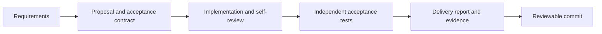
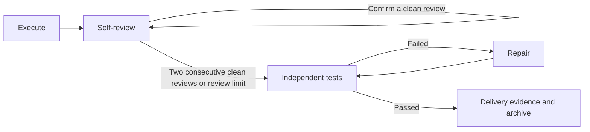

# SpecRelay

**Clear specs. Coordinated agents. Verified delivery.**

SpecRelay turns a requested change into a reviewable delivery. Define the requirements and acceptance checks, then let AI roles take turns implementing, reviewing, testing, and documenting the result.

[简体中文](README.zh-CN.md)

## Why SpecRelay

Fast code generation does not guarantee shared requirements or reviewable results. SpecRelay connects each requested change to explicit acceptance criteria, executable checks, and evidence a reviewer can inspect.



## Install and start

```bash
go install github.com/DeeliN221/specrelay@latest
specrelay install --global
specrelay flow config
# Ask your coding agent to create a proposal, then exit the agent session.
specrelay flow run
specrelay flow watch
```

Prebuilt binaries are available on the [GitHub releases page](https://github.com/DeeliN221/specrelay/releases). `specrelay install --global` installs the bundled skills into `~/.agents/skills`; it does not install the agent itself.

## Choose a change size

| Size | Use when | Artifacts |
| --- | --- | --- |
| micro | An implementation-only fix does not change observable behavior, command contracts, state semantics, or lasting specifications | Tests and a Git commit; no change directory |
| small | One business intent, at most two acceptance scenarios or required tests, and no complex design disagreement | `brief.md`, `acceptance.json`, and `tests/` |
| standard | A change spans modules, introduces a high-risk migration, covers several scenarios, or exceeds the small limits | `brief.md`, `proposal.md`, `design.md`, `spec.md`, `acceptance.json`, and `tests/` |

Counts help classify a change; they are not targets for inventing extra tests or tasks. Both small and standard changes live in `docs/changes/<number>-<description>/`, for example `12-rewrite-specrelay-cli`. English names are the default; Unicode names remain supported.

A small change still identifies where lasting behavior belongs. Archiving merges that behavior into `docs/specs/` and the relevant test intent into `tests/specs/`. Active proposals do not use `task.md`: creation defines the goal, boundaries, and acceptance method, while the executor adjusts implementation steps to the current results.

English specifications use headings such as `### Requirement: Retain archived tests` and `#### Scenario: Archive a change`, with normative words such as MUST, SHALL, or SHOULD. Existing Chinese specifications remain readable for compatibility.

For small work, allow at most two acceptance scenarios or two required tests. Escalate to standard for cross-module changes, higher risk or complex design. Do not invent tests or tasks to inflate a proposal. Small proposals still name their long-term specification and test destination; micro changes use TDD and a git commit.

Skills define how each role works; the change directory stores the proposal and tests. `acceptance.json` defines the executable contract and evidence. `specrelay flow` controls when stages advance through validation gates.

## Commands

```text
specrelay install --global       Install bundled agent skills
specrelay create                 Print the next proposal number
specrelay list                   List changes
specrelay status <change>        Inspect proposal artifacts
specrelay validate <change>      Validate the proposal contract
specrelay archive <change> --yes Archive a proposal with valid submission evidence
specrelay flow config            Write the default workflow configuration
specrelay flow run               Execute a change
specrelay flow status            Inspect workflow state
specrelay flow watch             Watch progress
specrelay flow restart           Resume after resolving a blocking condition
specrelay flow archive           Archive a failed run or batch record
```

Use `--help` on a command for its full options. Commands that support `--json` keep stable machine-readable fields.

## Configuration

Configuration is merged in this order:

```text
built-in defaults → ~/oz-flow.yaml → repository oz-flow.yaml → run snapshot
```

`specrelay flow config` writes the embedded default configuration. Its only optional scope flag is `--global`; it does not provide profiles or profile-selection flags. Edit the generated `oz-flow.yaml` when a project needs different behavior.

```yaml
max_audit_iterations: 3
validation:
  limit: 3
  commands:
    - go test ./...
```

`max_audit_iterations` limits complete self-review rounds before independent acceptance testing. The default is `3`; `0` permits unlimited rounds.

## Workflow



The executor runs repository pre-commit hooks before independent testing, absorbs any resulting changes, and runs the hooks again to confirm stable files. It then reruns tests and creates a snapshot. Archiving must not be the first stage to rewrite those files.

Missing credentials, configuration, or external services pause a run with a reason. Repeated failures without progress also stop instead of looping forever. After correcting the environment or input, use `specrelay flow restart` to resume.

## Delivery and evidence

Accepted small and standard proposals retain their final evidence in `tests/evidence/proposals/<change>/`:

- `DELIVERY.md` explains what changed and how a reviewer can verify it.
- A playable demonstration shows the requested behavior.
- Before/after screenshots, videos, logs, or result files show the effect of a fix.
- The final passing acceptance result is preserved so later runs cannot overwrite it.

Implementation, tests, the archived proposal, and these materials belong in the same reviewable commit. `test-results/` holds reproducible temporary output and stays outside Git.

There are three different archive operations:

| Operation | Purpose |
| --- | --- |
| `specrelay archive <change> --yes` | Move a proposal, including its tests, into `docs/changes/archive/` and rewrite its relative test references; requires a valid submission evidence bundle |
| Automatic workflow archive | Generate the delivery report and evidence after acceptance passes, then archive the proposal and merge lasting specifications/tests |
| `specrelay flow archive` | Archive an already failed run or batch record; this does not declare the proposal delivered |

## Optional external skills

The bundled `specrelay-plan`, `specrelay-create`, `specrelay-exec`, and `specrelay-archive` skills enforce SpecRelay's contracts and evidence requirements. They may call separately installed Matt Pocock skills for focused assistance:

| Stage | Optional skills | Purpose |
| --- | --- | --- |
| Planning | `/grill-with-docs`, `/wayfinder`, `/domain-modeling` | Clarify intent, choices, and terminology |
| Create | `/to-spec`, `/to-tickets`, `/prototype`, `/domain-modeling` | Draft specifications, explore designs, and prototype |
| Execute | `/implement`, `/tdd`, `/code-review`, `/prototype`, `/diagnosing-bugs`, `/codebase-design` | Implement, test, review, and diagnose |
| Archive | `/writing-for-agents`, `/domain-modeling` | Improve delivery notes and terminology |

`specrelay install` does not install these external skills. Install them separately in the harness's skill directory. They do not replace `acceptance.json`, executable tests, or read-only stage boundaries.

## Build, test, and release

```bash
go test ./...
go build -o specrelay ./cmd/specrelay
bash scripts/extract-release-notes.sh CHANGELOG.md v0.0.0-local /tmp/specrelay-release-notes.md
```

Both GitHub Actions CI and Release run the Go test suite. Version tags trigger cross-platform release builds. Release notes are extracted from the matching version or the Unreleased section of [CHANGELOG.md](CHANGELOG.md), and the complete changelog is attached.

## When to use it

SpecRelay works best for changes that benefit from explicit requirements and reviewable acceptance evidence. Small cosmetic or routine edits may only need tests and a normal commit.

## Migrating from Oz

Install `specrelay` and use it wherever you previously ran `oz`. Existing `oz-flow.yaml` / `oz-flow.yml`, user-level `~/oz-flow.yaml`, and the `oz/flow` state directory retain their locations. JSON contract fields and `OZ_*` environment variables retain their existing spelling. Stop active runs before switching executables.

Run `specrelay install --global` to install the renamed skills. User-owned skills are not deleted automatically. Old releases are not required by the new updater.

Release archives also include an `oz` compatibility executable for saved
prompts and integrations that still invoke the old command. Go users can
install it with `go install github.com/DeeliN221/specrelay/cmd/oz@latest`.
Both entry points run the same implementation. New projects and skills use
`specrelay`; existing prompt text is not rewritten automatically.
